# 知行 · AI 学习系统 V2

把个人资料转为可检索的学习内容，形成“提问—练习—反馈—复习—再推荐”的学习闭环。面向毕业设计与本地作品集演示，采用有工具边界的学习教练与可解释规则，没有训练能力预测模型。

**作品集定位：** 一个可本地部署、可追溯证据、具有权限与事务边界的多用户学习闭环。重点展示 RAG 工程、受限工具 Agent、可解释自适应策略和实验诚信。S6 冻结业务功能，生产算法仍为 **rules_v2**。

[无付费模型演示 / 8分钟流程](PORTFOLIO_DEMO.md) · [1分钟 / 3分钟面试讲稿与17个技术追问](PORTFOLIO_INTERVIEW.md) · [S6 发布审查](S6_PORTFOLIO_RELEASE.md) · [发布前复核](GITHUB_RELEASE_REVIEW.md) · [PowerShell 上传](GITHUB_PUBLISH_POWERSHELL.md) · [部署手册](DEPLOYMENT.md) · [S5 验收证据](S5_FINAL_DELIVERY.md)

| 项目要点 | 实际实现 |
| --- | --- |
| 学习闭环 | 资料 → 带证据问答 → 知识点练习 → 事务判分 → 掌握度 → 推荐 → 错题复习 |
| 工程重点 | 服务端 JWT/RBAC、跨用户隔离、答题幂等、教练恢复、Docker 迁移与备份 |
| 评估态度 | 检索开发集、合成回放、历史观察、浏览器验收分别报告；没有已证实的真人学习收益 |
| 运行边界 | Python 3.13、单 Uvicorn worker、SQLite、本机 Docker；不是已验证的公网大规模服务 |

## 界面预览

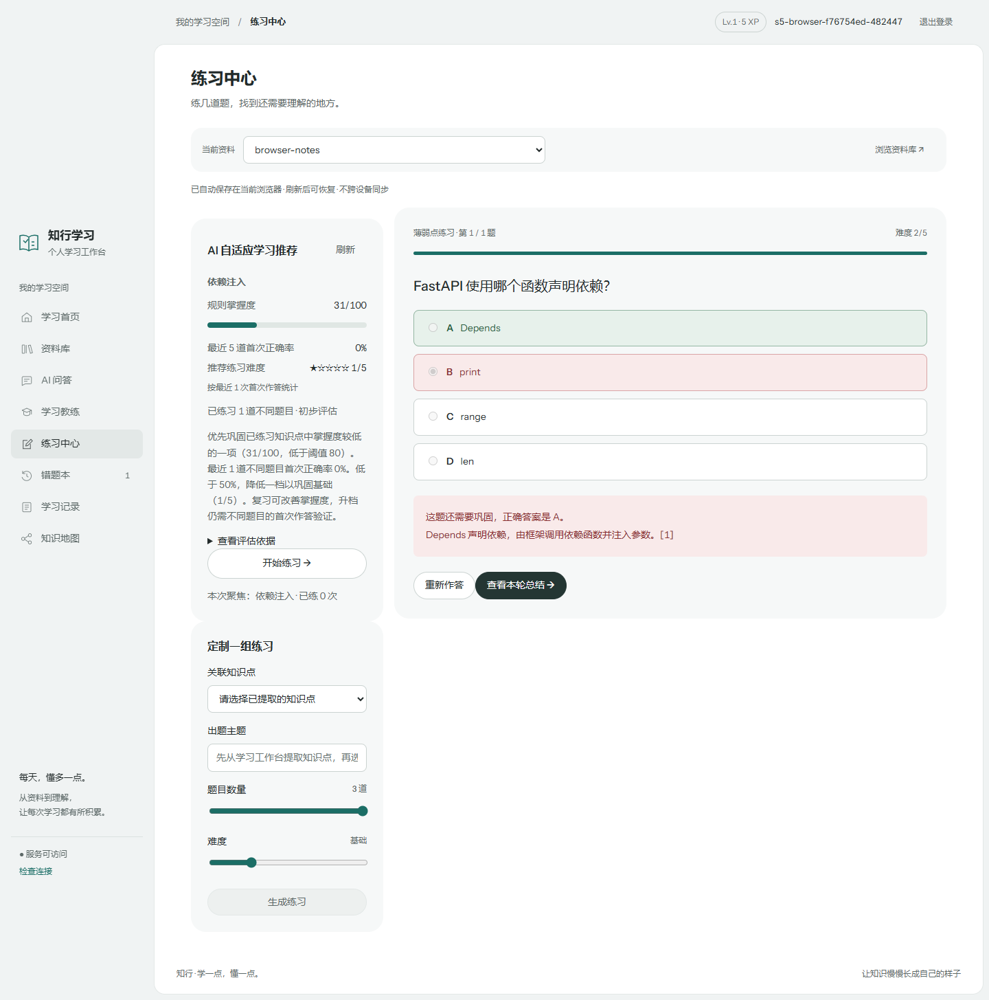

<details>
<summary>知识地图、RAG、学习教练与管理员（含手机端）</summary>

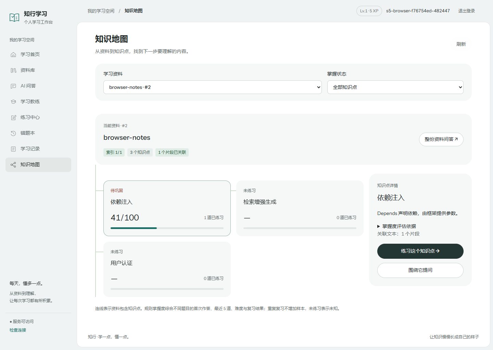
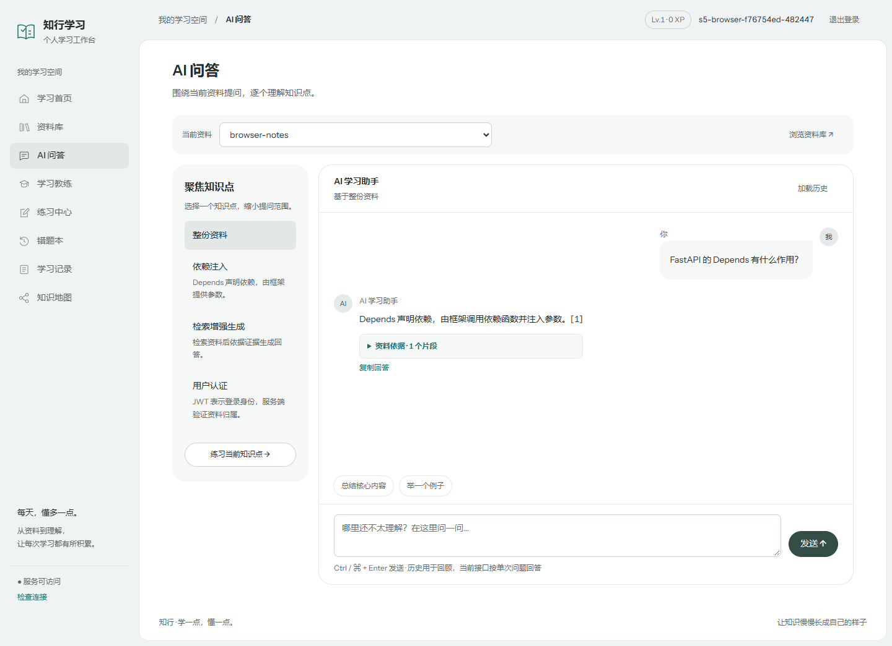
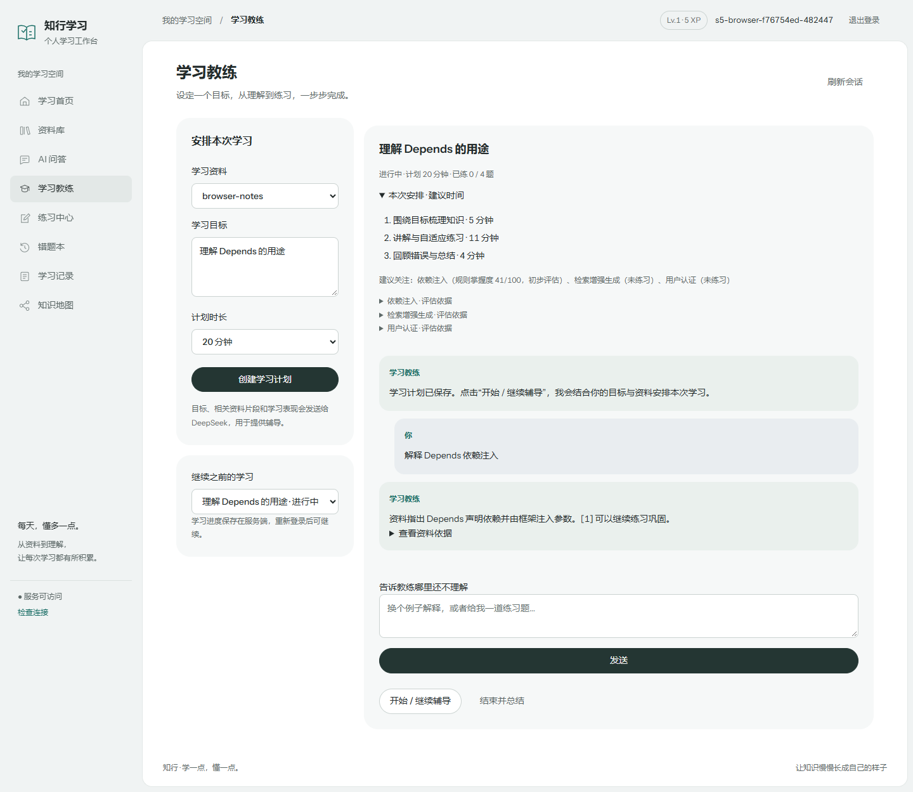
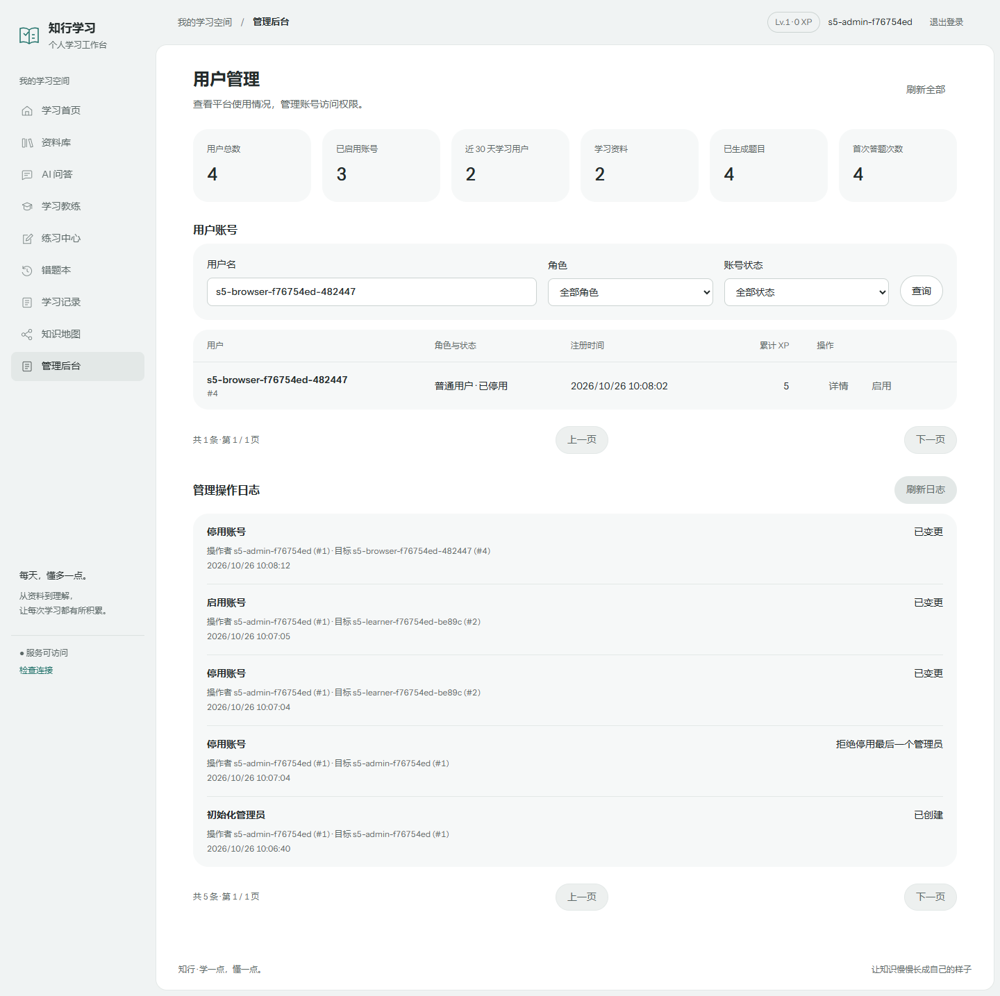
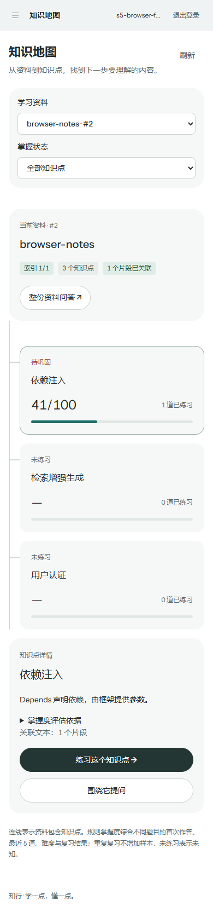
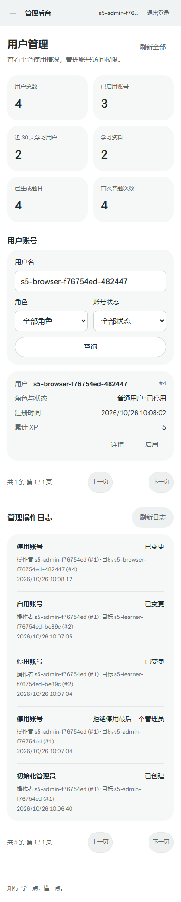

</details>

截图来源：S6 隔离 Docker、真实 Edge 交互、本地模型替身、合成账号和资料；0真人参与者，不表示真实模型质量或学习效果。[来源及校验指纹](docs/portfolio/README.md)。

## 已实现功能

- 注册/JWT/资料隔离；管理员搜索用户、最小化统计、账号启停及审计。
- TXT/Markdown/DOCX/PDF 导入、去重、分块、百炼向量和知识点提取。保存解析文本，原件在内存解析，不作原件归档。
- 有来源片段的 RAG，默认向量检索，可选 BM25、RRF 混合和重排。
- 知识点出题、先保存答案再获取可选 AI 反馈、错题复习、XP/成就、学习记录。
- 自适应推荐、知识地图、统一掌握度解释，以及可恢复的学习教练会话。
- 与学习数据库隔离的时间回放、人工审题、前测/学习/后测 CLI、脱敏导出及论文图表。

## 总体架构与技术栈

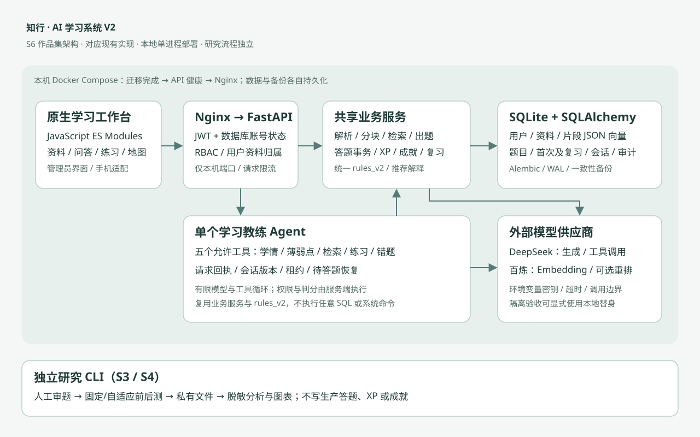

下图为可编辑 Mermaid 版本：

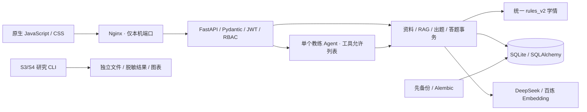

Python 3.13、FastAPI、SQLAlchemy 2、Alembic、Pydantic、python-jose/HS256、Argon2、OpenAI 兼容 SDK、NumPy、jieba；前端为浏览器 ES Modules。SQLite 保存原文、分块、JSON 向量及业务记录，不依赖外部向量数据库。Matplotlib 仅用于可选离线绘图，不进入生产镜像。默认一个 Uvicorn worker，适合本地及少量演示用户。

### RAG 流程

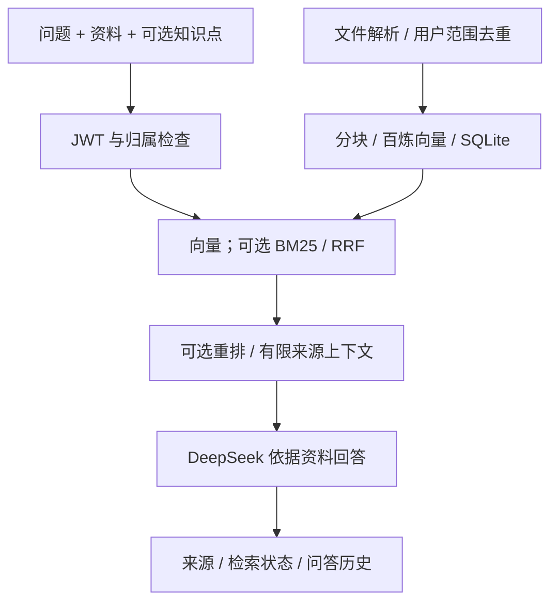

资料不足及服务失败有显式状态和降级，不能保证模型解释正确。重排默认关闭，开启增加费用。分块知识点分类有调用预算，大资料可能只有部分分块关联；不猜测回填。新题必须关联同资料有效知识点；没有专属分块时在同资料检索。[检索评测与限制](evaluation/README.md)。

### 学习教练

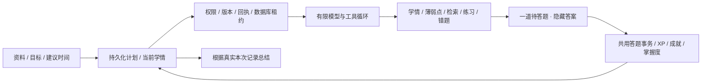

创建计划只保存数据，发消息才调用模型。模型选择教学动作，后端决定权限、判分和 XP。刷新、重新登录可恢复；重试沿用请求编号，同会话命令串行。每轮最多4次模型请求、6次工具，120秒后不再开始下一步，进行中的调用另受超时约束；每进程最多2条教练消息并行，每会话最多60次操作。教练与普通模型请求分别限流，不是金额预算。

### 掌握度与推荐

用户、资料、有效知识点范围内，按首次答题时间去重不同题目。首次正误为 a、最新复习正误为 r：未复习 y=a，已复习 y=0.7a+0.3r。难度 d 的成功权重0.6+0.2d，失败权重1.6−0.2d；集合得分 C=(1+Σ成功证据)/(2+Σ成功证据+Σ失败证据)。掌握度=round(100×(0.7×历史 C+0.3×最近五题 C))。

无历史返回 null；单题不会直接变100；重复复习不增加样本数。分数是规则指数，不是正确率或经校准的能力概率。卡片、地图、薄弱点及教练采用同一服务；读接口不补写快照、不出题。

难度按同知识点最近最多五道不同新题的首次正确率：≥80%且至少三题提高一档，<50%降一档，其余保持，范围1～5，无历史默认2。有待答自适应题时继续原题。选点先巩固已知薄弱，再探索未知，最后巩固规则达标项；解释选点、掌握度、难度和近期表现。[完整公式与样例](S2_TOPIC_MASTERY.md)。

### 权限与数据库

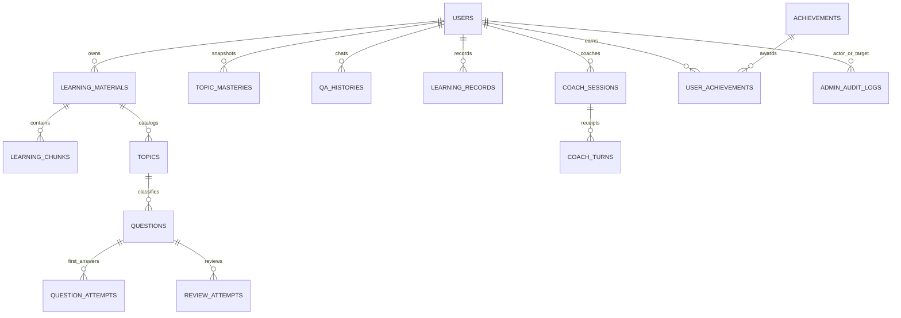

每次认证读取数据库 is_active/auth_version，服务端 get_current_admin 决定权限。账号启停使旧 JWT 版本失效，重新启用仍需登录。注册拒绝 role 等额外字段；管理员详情不返回私人资料/对话。防自禁用/最后管理员及审计同事务。

首次答题采用有条件数据库更新，串行化同用户 XP/成就决策，防并发重复领奖与丢失 XP。复习、教练另有幂等约束。SQLite 单写者，未承诺大规模并发或跨主机部署。旧 NULL 知识点保留，直接 SQL/ORM 维护仍须遵守服务约束。[RBAC 说明](ADMIN_RBAC.md)。

## 启动

不配置真实密钥也能运行[隔离模型替身演示](PORTFOLIO_DEMO.md)。下列正常模式需要你自己的供应商密钥，模型请求可能收费。

```powershell
# 先进入你克隆或解压后的项目根目录；不需要作者的磁盘路径。
py -3.13 -m venv .venv
.\.venv\Scripts\python.exe -m pip install -r requirements.lock
if (!(Test-Path .env)) { Copy-Item .env.example .env }
# 填入随机 SECRET_KEY、模型密钥及工作区地址。已有 .env 不要覆盖。
# 已有数据先备份，详见部署手册。
.\.venv\Scripts\python.exe -m scripts.container_start
.\.venv\Scripts\python.exe -m scripts.init_admin
.\.venv\Scripts\python.exe -m uvicorn app.main:app --host 127.0.0.1 --port 8000
```

打开 http://127.0.0.1:8000/app。SECRET_KEY 至少32随机字节。新库初始化3项基础成就，已有库不会自动改动成就目录。管理员 CLI 必须在交互终端输入独特用户名和至少15字符密码，不回显、不接受参数或管道、不提升已有普通账户；已有管理员时拒绝重复执行。

本地默认 learning.db；APP_DATA_DIR 可指定独立目录，Docker 固定 /data。启动检查配置与 Alembic head（0005），不跳过迁移。

```powershell
if (!(Test-Path .env.docker)) { Copy-Item .env.docker.example .env.docker }
# 填入自己的随机 SECRET_KEY、模型密钥和 HTTPS 工作区地址。
docker compose up -d --build --wait
docker compose exec app python -m scripts.init_admin
docker compose ps
```

Docker 页面 http://127.0.0.1:8080/app，仅本机端口。数据与备份分卷，代码只读、非 root，镜像无正式密钥或数据。备份/迁移→API健康→Nginx。[启动、停止、日志、升级、迁入旧库与恢复](DEPLOYMENT.md)。不要用 down -v 删除卷。

## 实验结果和边界

| 来源 | 已有实测事实 | 不能证明 |
| --- | --- | --- |
| S2 固定规则序列 | 难度2单题答对旧100→新67；同错题复习答对20次旧100→新41 | 真人能力预测更准 |
| S3 合成序列 | 408共同预测目标；历史/最近五题/S2 score-proxy Brier为0.3097/0.2568/0.2730 | S2总是最好或真实学习提升 |
| S3 既有历史 | 51首次+5复习，仅10条可归因；满足最低历史的预测目标仅2个 | 可靠真实预测率或因果收益 |
| S4 操作演示 | 4脚本编号、48次输入、0真人；28候选题默认全部待审 | 合格真人实验或已验证A/B等价性 |
| S5 工程验收 | 替身/真实HTTP/浏览器/在线模型分开报告 | 在线成功等于内容准确或容量达标 |

S3 同时公开最近五题规则优于 S2 的部分合成指标；N/A不画成0。[S2](S2_TOPIC_MASTERY.md)、[S3](S3_ADAPTIVE_EVALUATION.md)、[S4](S4_EXPERIMENT_PREPARATION.md) 记录来源、统计口径、防未来泄漏和限制。真人实验须先审题、核查难度与卷等价性、取得知情同意；研究文件不进入仓库和生产镜像。

## 验证和面试演示

```powershell
.\.venv\Scripts\python.exe -X utf8 -m scripts.run_s5_tests --output-dir .s6-local/my-regression
.\.venv\Scripts\ruff.exe check --no-cache app tests scripts migrations rebuild_embeddings.py
# 隔离 Docker 验收准备见部署手册。
.\.venv\Scripts\python.exe -m scripts.s5_acceptance --help
# 显式启用真实模型，会产生供应商费用；仅使用临时数据库。
.\.venv\Scripts\python.exe -m scripts.s5_online_check --run-live
```

实际报告在 evaluation/reports/s5/。单元/DOM使用替身，真实HTTP+替身、真实Edge+替身、真实供应商在线检查分别标记。Node DOM脚本使用实验性 VM Modules，保留既有监听器提示；浏览器需 Edge/Playwright。

详细演示和网络失败时的替身方案见 [PORTFOLIO_DEMO.md](PORTFOLIO_DEMO.md)。面试建议8～10分钟：注册→导入可公开小资料→带来源问答→答错→地图与推荐解释→复习但不重复XP→教练→管理员停用测试账号并展示旧JWT失效→说明实验为何尚不能证明学习效果。最后展示健康、备份恢复、分层测试证据。

可在已验证的本机隔离环境演示。公网前仍需 TLS、密钥/备份权限、消费额度、依赖漏洞复查、监控与容量测试；Token存储、单进程限流、SQLite等风险见S5交付。

## 仓库与发布说明

代码/配置与合成示例可作为公开候选；正式数据库、运行时环境变量、备份、私有研究记录和本地调试截图不应提交。不要直接打包整个工作目录。S6 提供只读安全扫描和本地白名单快照工具，均不暂存、提交或推送。[公开范围与剩余风险](S6_PORTFOLIO_RELEASE.md)。

旧 RAG 标签绑定作者当时的资料片段，公开库不分发原语料/向量及账号；空库不能直接复现旧100题成绩。独立复现可运行合成资料业务演示、单元测试和 S3 合成回放，再用自己的语料重标新评测集。项目许可证和第三方资料权利需作者在公开前确认，当前不自动授予新开源许可证。

公开精简版暂不分发来源权利待确认的旧 RAG 问句、标签及逐题报告；保留[历史检索数值摘要](evaluation/reports/rag-public-summary.md)。脚本默认指向的旧数据集不在此快照，新的 RAG 评测必须显式使用自己的已授权语料和 --dataset 路径。S3 合成回放、单元/DOM测试和替身演示可独立运行。[第三方许可与待确认项](THIRD_PARTY_NOTICES.md)。

若需运行含绘图的全部264项后端测试，另安装 evaluation/requirements.txt；未安装时2项绘图测试会明确跳过。
